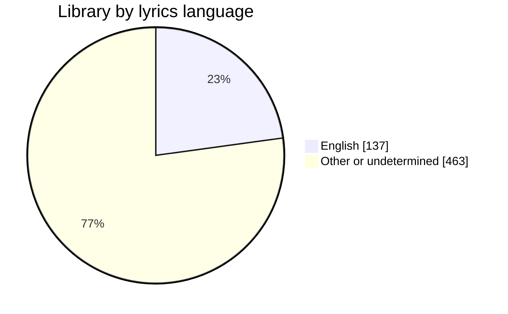

# KK Songbook

**[Download the offline songbook](https://github.com/krystofkomanec/zpevnik-kk/releases/latest/download/index.html)**

Open the downloaded `index.html` in your browser on a tablet, phone, or computer. The file includes the app and the song library. Once downloaded, it works offline.

## Playing songs

Search the library by song title or artist. On smaller screens, the menu button opens the library. Expand **Guitar chords** to see six-string chord shapes, including open and muted strings. Use the song controls to transpose or resize the text. The header lets you switch appearance and language. **English** shows songs with English lyrics, while **Čeština** shows the full collection. Both modes use Czech chord names (H and B).

Select **Play mode** to hide the controls. Landscape screens at least 700 pixels wide display two columns. Tap the screen edges or use the arrow keys to turn pages. Choose **Save** beside the transposition controls to remember the displayed offset for this song. Clicking the checked button clears it.

Long-press a line, right-click it, or focus it and press Enter to report a missing chord, a misplaced chord, or incorrect lyrics. Reports stay in this browser until you export them together from **Library tools → Export reports**. Send the exported JSON to share your corrections.

The [automatic arrangement checks](./ARRANGEMENT-CHECKS.md) run on every publication and link directly to lines that may need a correction.

## Updating your library

Open **Library tools** and select **Check for updates** while online. The check compares your local data version with a small version file. If a newer library is available, select **Load latest songs**. The browser keeps the update for offline use. If direct loading is unavailable, follow the download link shown in the app and select the downloaded `library.json`. To update the app itself, download the latest HTML file above.

## Adding a song

1. Open the [PDF inbox](https://github.com/krystofkomanec/zpevnik-kk/upload/main/inbox). Upload one song per PDF, named `Artist - Title.pdf`. Adding files requires repository write access.
2. Commit the upload to `main`. The [publishing workflow](https://github.com/krystofkomanec/zpevnik-kk/actions/workflows/import.yml) extracts text or reads scanned pages with OCR, detects the language from the lyrics, aligns chords with lyrics, and publishes an updated library. Single-column sheets with chords above the lyrics work best.
3. After the workflow completes, check for updates in the app. Sheets awaiting conversion are listed in the [conversion overview](#conversion-overview) below. For a correction to an existing arrangement, edit its [ChordPro file](./ChordPro/) and commit the change. Review OCR transcriptions against the source, especially chord symbols and verse order.

Uploaded PDFs are stored in the repository and inherit its visibility.


## Library statistics

<!-- statistics:start -->
**600 songs** · 0 added · 83 revisions since tracking began.



The initial 600 arrangements form the baseline. Each subsequent entry records the author and date of the source commit.

### Published changes by month

```text
2026-11  ████████████████████████  0 added · 83 updated
```

| Date | Song | Change | Revision | Contributor |
|---|---|---|---:|---|
| 2026-11-27 | Druhá tráva – Sbohem Angelíno | Updated | 2 | krystofkomanec |
| 2026-11-27 | Kamelot – Fénix | Updated | 2 | krystofkomanec |
| 2026-11-27 | Čechomor – Tady jsem doma | Updated | 2 | krystofkomanec |
| 2026-11-27 | Michal Hrůza – Jsi má baletka, co tančí | Updated | 2 | krystofkomanec |
| 2026-11-27 | Filmová Hudba Cz – Chodí horou 300 ovec | Updated | 2 | krystofkomanec |
| 2026-11-27 | Václav Neckář – Časy se mění | Updated | 2 | krystofkomanec |
| 2026-11-27 | Karel Plíhal – Akordy | Updated | 2 | krystofkomanec |
| 2026-11-27 | Druhá tráva – Jak mlýn se točí svět | Updated | 2 | krystofkomanec |
| 2026-11-27 | Ivan Mládek – Dívka s modrou matrací | Updated | 2 | krystofkomanec |
| 2026-11-27 | Druhá tráva – Dřív než se rozloučíme | Updated | 2 | krystofkomanec |
| 2026-11-27 | Kamil Střihavka – Země vzdálená | Updated | 2 | krystofkomanec |
| 2026-11-27 | Ivan Mládek – Dívka s dolíčky | Updated | 2 | krystofkomanec |
| 2026-11-27 | František Nedvěd – Třetí pokus | Updated | 2 | krystofkomanec |
| 2026-11-27 | Hana Zagorová – Málokdo ví | Updated | 2 | krystofkomanec |
| 2026-11-27 | Jakub Smolík – Zahrada ticha | Updated | 2 | krystofkomanec |
| 2026-11-27 | Bluesberry – Za sto let | Updated | 2 | krystofkomanec |
| 2026-11-27 | Hana Hegerová – Čerešne | Updated | 2 | krystofkomanec |
| 2026-11-27 | Vladimír Mišík – Jednohubky | Updated | 2 | krystofkomanec |
| 2026-11-27 | Petr Hapka – Na Hotelu V Olomouci | Updated | 2 | krystofkomanec |
| 2026-11-27 | Druhá tráva – Odpočiň si, Sáro (verze 2) | Updated | 2 | krystofkomanec |
| 2026-11-27 | Jelen – Klidná jako voda | Updated | 2 | krystofkomanec |
| 2026-11-27 | Druhá tráva – Ještě není tma | Updated | 2 | krystofkomanec |
| 2026-11-27 | Lidové písně – A te Rehradice | Updated | 2 | krystofkomanec |
| 2026-11-27 | Druhá tráva – Dívka ze severu | Updated | 2 | krystofkomanec |
| 2026-11-27 | Vladimír Mišík – Stříhali dohola malého chlapečka | Updated | 2 | krystofkomanec |
| 2026-11-27 | Čechomor – Hej, bystrá voda | Updated | 2 | krystofkomanec |
| 2026-11-27 | Druhá tráva – Čeká nás poslední ráno (One Too Many Mornings) | Updated | 2 | krystofkomanec |
| 2026-11-27 | Záviš – Čepice | Updated | 2 | krystofkomanec |
| 2026-11-27 | Druhá tráva – Až si jednou | Updated | 2 | krystofkomanec |
| 2026-11-27 | Mňága &amp; Žďorp – Nagasaki Hirošima | Updated | 2 | krystofkomanec |
| 2026-11-27 | Záviš – Cukrářská | Updated | 2 | krystofkomanec |
| 2026-11-27 | The Animals – The House of the Rising Sun | Updated | 2 | krystofkomanec |
| 2026-11-27 | Čechomor – Stojí hruška v širém poli | Updated | 2 | krystofkomanec |
| 2026-11-27 | Druhá tráva – Marcipán z Toleda | Updated | 2 | krystofkomanec |
| 2026-11-27 | Čechomor – Proměny | Updated | 2 | krystofkomanec |
| 2026-11-27 | Traband – Cirkus Praha | Updated | 2 | krystofkomanec |
| 2026-11-27 | Traband – Černej pasažér | Updated | 2 | krystofkomanec |
| 2026-11-27 | Traband – Deža ví | Updated | 2 | krystofkomanec |
| 2026-11-27 | Traband – Doma nejlíp | Updated | 2 | krystofkomanec |
| 2026-11-27 | Traband – Duchové zemřelých | Updated | 2 | krystofkomanec |
| 2026-11-27 | Traband – Dva rychlý vlaky | Updated | 2 | krystofkomanec |
| 2026-11-27 | Traband – Historka z podsvětí | Updated | 2 | krystofkomanec |
| 2026-11-27 | Traband – Jaromil Hodněpil | Updated | 2 | krystofkomanec |
| 2026-11-27 | Traband – Jdu krajinou | Updated | 2 | krystofkomanec |
| 2026-11-27 | Traband – Kantorovy varhany | Updated | 2 | krystofkomanec |
| 2026-11-27 | Traband – Koleda | Updated | 2 | krystofkomanec |
| 2026-11-27 | Traband – Kolotoč | Updated | 2 | krystofkomanec |
| 2026-11-27 | Traband – Lano, co k nebi nás poutá | Updated | 2 | krystofkomanec |
| 2026-11-27 | Traband – Leží dáma na kolejích | Updated | 2 | krystofkomanec |
| 2026-11-27 | Traband – Marie! | Updated | 2 | krystofkomanec |
| 2026-11-27 | Traband – Markéto! | Updated | 2 | krystofkomanec |
| 2026-11-27 | Traband – Měla jsem já pejska | Updated | 2 | krystofkomanec |
| 2026-11-27 | Traband – Milovaný syn | Updated | 2 | krystofkomanec |
| 2026-11-27 | Traband – Moji učitelé | Updated | 2 | krystofkomanec |
| 2026-11-27 | Traband – Mraky | Updated | 2 | krystofkomanec |
| 2026-11-27 | Traband – Na širém moři | Updated | 2 | krystofkomanec |
| 2026-11-27 | Traband – Nad Koločavou | Updated | 2 | krystofkomanec |
| 2026-11-27 | Traband – Nejsem sám | Updated | 2 | krystofkomanec |
| 2026-11-27 | Traband – Namám rád trpaslíky | Updated | 2 | krystofkomanec |
| 2026-11-27 | Traband – Nezdárný syn | Updated | 2 | krystofkomanec |
| 2026-11-27 | Traband – Obešel jsem horu | Updated | 2 | krystofkomanec |
| 2026-11-27 | Traband – Orel &amp; panna | Updated | 2 | krystofkomanec |
| 2026-11-27 | Traband – Pálíš, doutnáš, nehoříš | Updated | 2 | krystofkomanec |
| 2026-11-27 | Traband – Paní domácí | Updated | 2 | krystofkomanec |
| 2026-11-27 | Traband – Pět prstů | Updated | 2 | krystofkomanec |
| 2026-11-27 | Traband – Ponorná řeka | Updated | 2 | krystofkomanec |
| 2026-11-27 | Traband – Princezna Lada | Updated | 2 | krystofkomanec |
| 2026-11-27 | Traband – Přijíždí posel | Updated | 2 | krystofkomanec |
| 2026-11-27 | Traband – Ranní rány | Updated | 2 | krystofkomanec |
| 2026-11-27 | Traband – Romeo &amp; Julie po dvaceti letech | Updated | 2 | krystofkomanec |
| 2026-11-27 | Traband – Tak to mám rád | Updated | 2 | krystofkomanec |
| 2026-11-27 | Traband – Taková ženská | Updated | 2 | krystofkomanec |
| 2026-11-27 | Traband – Tlustý muž | Updated | 2 | krystofkomanec |
| 2026-11-27 | Traband – V jejích šlépějích | Updated | 2 | krystofkomanec |
| 2026-11-27 | Traband – V oku dravce | Updated | 2 | krystofkomanec |
| 2026-11-27 | Traband – Ve zlatém kočáře | Updated | 2 | krystofkomanec |
| 2026-11-27 | Traband – Vetřelec | Updated | 2 | krystofkomanec |
| 2026-11-27 | Traband – Viděl jsem člověka | Updated | 2 | krystofkomanec |
| 2026-11-27 | Traband – Vraťte mi mou hlavu | Updated | 2 | krystofkomanec |
| 2026-11-27 | Traband – Zlá/sky | Updated | 2 | krystofkomanec |
| 2026-11-27 | Mňága &amp; Žďorp – Měsíc | Updated | 2 | krystofkomanec |
| 2026-11-27 | Michal Prokop – Blues o spolykaných slovech | Updated | 2 | krystofkomanec |
| 2026-11-27 | Tradiční – Bella Ciao | Updated | 2 | krystofkomanec |
<!-- statistics:end -->

## Conversion overview

<!-- pending:start -->
7 source files awaiting conversion.

<ul>
<li>Wohnout - LSD.pdf</li>
<li>pocity.png</li>
<li>David Stypka - Láska není (verze 2).pdf</li>
<li>Jaromír Nohavica - Hlídač krav.pdf</li>
<li>Poutníci - Až uslyším hvízdání.pdf</li>
<li>Pavel Dydovič - Bláznova ukolébavka.pdf</li>
<li>Škwor - Síla starejch vín.pdf</li>
</ul>
<!-- pending:end -->
