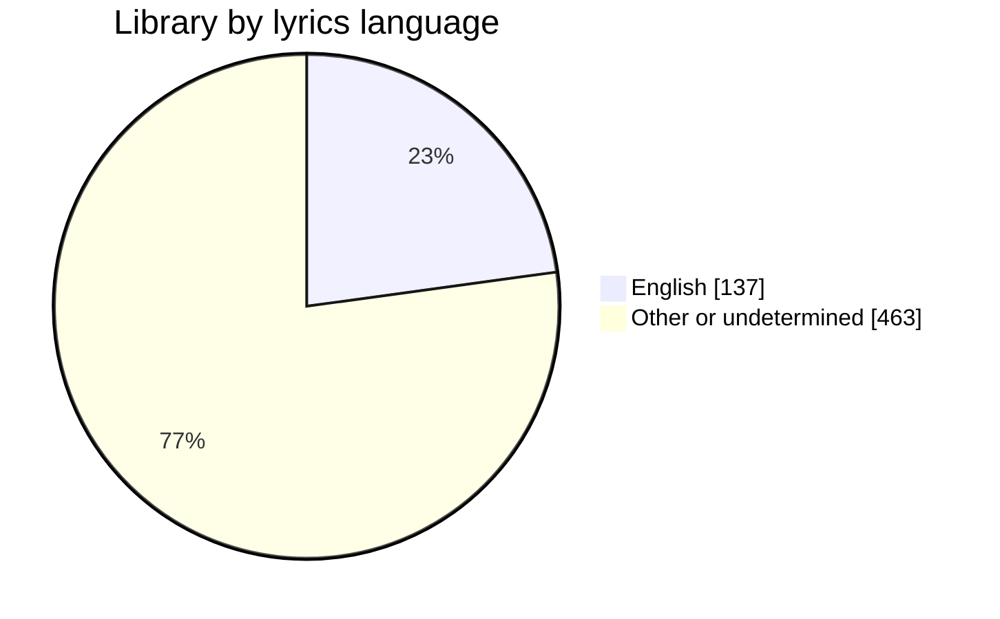

# KK Songbook

**[Download the offline songbook](https://github.com/krystofkomanec/zpevnik-kk/releases/latest/download/index.html)**

Open the downloaded `index.html` in your browser on a tablet, phone, or computer. The file includes the app and the song library. Once downloaded, it works offline.

## Playing songs

Search the library by song title or artist. On smaller screens, the menu button opens the library. Expand **Guitar chords** to see six-string chord shapes, including open and muted strings. Use the song controls to transpose or resize the text. The header lets you switch appearance and language. **English** shows songs with English lyrics, while **Čeština** shows the full collection. Both modes use Czech chord names (H and B).

## Updating your library

Open **Library tools** and select **Check for updates** while online. The check compares your local data version with a small version file. If a newer library is available, select **Load latest songs**. The browser keeps the update for offline use. If direct loading is unavailable, follow the download link shown in the app and select the downloaded `library.json`. To update the app itself, download the latest HTML file above.

## Adding a song

1. Open the [PDF inbox](https://github.com/krystofkomanec/zpevnik-kk/upload/main/inbox). Upload one song per PDF, named `Artist - Title.pdf`. Adding files requires repository write access.
2. Commit the upload to `main`. The [publishing workflow](https://github.com/krystofkomanec/zpevnik-kk/actions/workflows/import.yml) extracts text or reads scanned pages with OCR, detects the language from the lyrics, aligns chords with lyrics, and publishes an updated library. Single-column sheets with chords above the lyrics work best.
3. After the workflow completes, check for updates in the app. Sheets awaiting conversion are listed in the [conversion overview](#conversion-overview) below. For a correction to an existing arrangement, edit its [ChordPro file](./ChordPro/) and commit the change. Review OCR transcriptions against the source, especially chord symbols and verse order.

Uploaded PDFs are stored in the repository and inherit its visibility.


## Library statistics

<!-- statistics:start -->
**600 songs** · 0 added · 1 revisions since tracking began.



The initial 600 arrangements form the baseline. Each subsequent entry records the author and date of the source commit.

### Published changes by month

```text
2026-11  ████████████████████████  0 added · 1 updated
```

| Date | Song | Change | Revision | Contributor |
|---|---|---|---:|---|
| 2026-11-27 | Tradiční – Bella Ciao | Updated | 2 | krystofkomanec |
<!-- statistics:end -->

## Conversion overview

<!-- pending:start -->
7 source files awaiting conversion.

<ul>
<li>Wohnout - LSD.pdf</li>
<li>pocity.png</li>
<li>David Stypka - Láska není (verze 2).pdf</li>
<li>Jaromír Nohavica - Hlídač krav.pdf</li>
<li>Poutníci - Až uslyším hvízdání.pdf</li>
<li>Pavel Dydovič - Bláznova ukolébavka.pdf</li>
<li>Škwor - Síla starejch vín.pdf</li>
</ul>
<!-- pending:end -->
