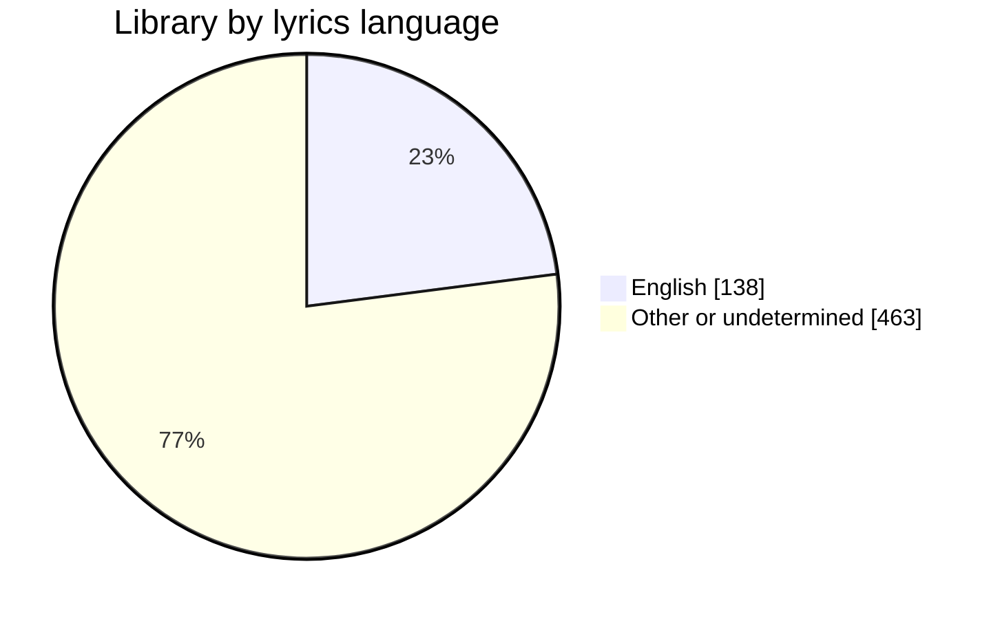

# KK Songbook

**[Download the offline songbook](https://github.com/krystofkomanec/zpevnik-kk/releases/latest/download/index.html)**

Open the downloaded `index.html` in your browser on a tablet, phone, or computer. The file includes the app and the song library. Once downloaded, it works offline.

## Playing songs

Search the library by song title or artist. On smaller screens, the menu button opens the library. Open **Guitar chords** to see six-string chord shapes, including open and muted strings. Select a chord, then **Other shapes** for the same chord in another position or **Chord variations** for optional changes in harmony. Close the chord window to return to the same place in the song. Suggestions use the displayed key and leave the score as written. Use the song controls to transpose or resize the text. The header lets you switch appearance and language. **English** shows songs with English lyrics, while **Čeština** shows the full collection. Both modes use Czech chord names (H and B).

Use **Sort by** to list titles alphabetically, by the original file timestamp preserved in the downloaded ZIP, or by import time in the app. Date sorts show newest first. Missing dates appear last. Songs from the same import are ordered by title. Edits keep the original addition date.

Select **Play mode** to hide the controls. Scroll vertically or use **Next page** at the bottom right to advance to the next group of rendered rows. Wrapped chord and lyric rows stay together, and there is room to scroll through expanded tablature. Page Up, Page Down and the arrow keys also turn pages. Change the text size with A−/A+ or pinch the score on a touch screen. The reader remembers the zoom for each song on this device. Open **Song settings** to adjust text size, transposition or capo. Changes are saved automatically on this device. Tap the transposition number between − and + to restore the original key.

In play mode, open **Playback** to start auto-scroll and set its speed. You can drag the score by hand in either direction. Auto-scroll resumes after the gesture and its momentum end, and stops at the end of the song. The silent **Metronome** pulses in the top bar at the selected tempo. Close the playback controls to give the music more space. Speed and tempo are remembered on this device, and exiting play mode stops both features.

Long-press a line, right-click it, or focus it and press Enter to report a missing chord, a misplaced chord, or incorrect lyrics. Reports stay in this browser until you export them together from **Library tools → Export reports**. Send the exported JSON to share your corrections.

The [automatic arrangement checks](./ARRANGEMENT-CHECKS.md) run on every publication and link directly to lines that may need a correction.

## Moving song settings between devices

Under **Library tools**, choose **Export song settings**. Copy the downloaded JSON file to your other device and choose **Import song settings** there. This works offline. The backup includes saved capo frets, transpositions and song zoom levels. Import merges settings per arrangement. Values in the file take precedence, and other saved values stay in place. The app accepts earlier filename-based backups and writes new backups using stable arrangement IDs.

### Library 10 arrangement review

The browser review opens all 601 arrangements at widths of 360, 768 and 1440 pixels and checks chord collisions and horizontal overflow. Source comparisons and the conversion checker also cover column order, source links, unmarked chord runs, joined words and repeated verses. The review queue above contains unresolved candidates. Positions supplied from a matching verse are editorial estimates. Seven arrangements include expandable instrumental tablature taken from the supplied sheets.

## Updating your library

Open **Library tools** and select **Check for updates** while online. The check compares your local data version with a small version file. If a newer library is available, select **Load latest songs**. The browser keeps the update for offline use. If direct loading is unavailable, follow the download link shown in the app and select the downloaded `library.json`. To update the app itself, download the latest HTML file above.

## Building the offline app

Edit the layout and styles in `app/` and the reader behavior in `cteni.js`. Run `python3 tools/build.py` from the repository root to embed the interface, share QR code and library in a single `index.html`. Open that file directly to test it offline.

Use `REPOSITORY_PRIVATE=false python3 tools/build.py` to match the public GitHub release. The build reads the arrangement collection from `ChordPro/*.cho` and the previous metadata and revision history from the checked-in `library.json`. It regenerates `library.json`, `knihovna.js`, `version.json` and the standalone HTML. The library version increases once when the published arrangement data changes, even if several arrangements change together.

Run the regression tests from the repository root. The PDF integration test uses Poppler's `pdftotext`. Install Tesseract with English and Czech language data to convert scanned PDFs.

```sh
python3 -m unittest discover -s tools -v
npm ci
npx playwright install chromium
npm test
```

The browser tests open the built HTML directly from disk and exercise mobile, tablet and desktop layouts. The **Validate songbook** workflow runs the same checks on pull requests with read-only repository permissions. The existing publishing workflow builds the downloadable releases from `main`.

### Arrangement IDs and PDF imports

- Every arrangement has a permanent UUID stored in the final `{x-arrangement-id: …}` directive of its ChordPro source. Commit the source for a new arrangement so the build can credit its contributor, then keep the ID added by the build. Move the directive with the file when renaming it, and retain it when correcting the arrangement. When copying a file to create a separate arrangement, remove the copied directive so the build assigns a new ID.
- The ID connects an arrangement to its previous revision and original import timestamps. A filename-only rename records the old filename as an alias and keeps the revision. Correcting the music or metadata creates a revision. The identity directive stays out of the rendered score and retains the source line numbers used by reports.
- The app migrates saved capo, transposition and zoom values from current and historical filenames when it first sees the ID. Line reports retain their original filename, line and revision and include the ID when the app can resolve it. Schema 1 library updates still load in earlier readers. Earlier readers use filenames for their own saved settings.
- `tools/imports.json` records each PDF's digest, the associated arrangement and whether the arrangement is still generated. Keep that record when deleting its ChordPro file so a later build does not reimport the PDF. The build detects manual corrections before replacing a generated arrangement from a changed PDF and lists the PDF for review.


## Adding a song

1. Open the [PDF inbox](https://github.com/krystofkomanec/zpevnik-kk/upload/main/inbox). Upload one song per PDF, named `Artist - Title.pdf`. Adding files requires repository write access.
2. Commit the upload to `main`. The [publishing workflow](https://github.com/krystofkomanec/zpevnik-kk/actions/workflows/import.yml) extracts text or reads scanned pages with OCR, detects the language from the lyrics, aligns chords with lyrics, and publishes an updated library. Single-column sheets with chords above the lyrics work best.
3. After the workflow completes, check for updates in the app. Sheets awaiting conversion are listed in the [conversion overview](#conversion-overview) below. For a correction to an existing arrangement, edit its [ChordPro file](./ChordPro/) and commit the change. Review OCR transcriptions against the source, especially chord symbols and verse order.

Uploaded PDFs are stored in the repository and inherit its visibility.


## Library statistics

<!-- statistics:start -->
**601 songs** · 1 added · 446 revisions since tracking began.



The initial 600 arrangements form the baseline. Each subsequent entry records the author and date of the source commit.

### Published changes by month

```text
2026-11  ████████████████████████  1 added · 446 updated
```

| Date | Song | Change | Revision | Contributor |
|---|---|---|---:|---|
| 2026-11-27 | twenty one pilots – Heathens | Updated | 3 | krystofkomanec |
| 2026-11-27 | All Time Low – Dear Maria, Count Me In | Updated | 3 | krystofkomanec |
| 2026-11-27 | Cage the Elephant – Rubber Ball | Updated | 3 | krystofkomanec |
| 2026-11-27 | Nirvana – The Man Who Sold The World | Updated | 4 | krystofkomanec |
| 2026-11-27 | Rybičky 48 – Klasický pomalý song | Updated | 3 | krystofkomanec |
| 2026-11-27 | Neil Young – Heart Of Gold | Updated | 3 | krystofkomanec |
| 2026-11-27 | Chinaski – Schody | Updated | 3 | krystofkomanec |
| 2026-11-27 | The Killers – Exitlude | Updated | 4 | krystofkomanec |
| 2026-11-27 | Goo Goo Dolls – Iris | Updated | 3 | krystofkomanec |
| 2026-11-27 | David Stypka – Jericho | Updated | 3 | krystofkomanec |
| 2026-11-27 | Rybičky 48 – Slibuju že nebudu pít | Updated | 4 | krystofkomanec |
| 2026-11-27 | Kabát – Na sever | Updated | 3 | krystofkomanec |
| 2026-11-27 | Anna K. – Nebe | Updated | 4 | krystofkomanec |
| 2026-11-27 | Vypsaná fixa – Robí Valentýn | Updated | 3 | krystofkomanec |
| 2026-11-27 | David Stypka – Vrány Taky | Updated | 3 | krystofkomanec |
| 2026-11-27 | Karel Kryl – Anděl | Updated | 3 | krystofkomanec |
| 2026-11-27 | Marek Ztracený – Ztrácíš se | Updated | 3 | krystofkomanec |
| 2026-11-27 | Chinaski – Láska a jiná násilí | Updated | 2 | krystofkomanec |
| 2026-11-27 | Vladimír Mišík – Jednou | Updated | 2 | krystofkomanec |
| 2026-11-27 | Ed Sheeran – I See Fire | Updated | 3 | krystofkomanec |
| 2026-11-27 | Lou Reed – Perfect Day | Updated | 4 | krystofkomanec |
| 2026-11-27 | Neil Young – Old Man | Updated | 2 | krystofkomanec |
| 2026-11-27 | Záviš – Čepice | Updated | 5 | krystofkomanec |
| 2026-11-27 | Richard Müller – Baroko | Updated | 3 | krystofkomanec |
| 2026-11-27 | Pink Floyd – Wish You Were Here | Updated | 3 | krystofkomanec |
| 2026-11-27 | Vladimír Mišík – Variace na renesanční téma | Updated | 3 | krystofkomanec |
| 2026-11-27 | Rangers (Plavci) – Pole s bavlnou | Updated | 2 | krystofkomanec |
| 2026-11-27 | Elán – Zanedbaný sex (kapo 3) | Updated | 3 | krystofkomanec |
| 2026-11-27 | Michal Tučný – Snídaně v trávě | Updated | 2 | krystofkomanec |
| 2026-11-27 | Poutníci – Zdálo se mně, zdálo | Updated | 2 | krystofkomanec |
| 2026-11-27 | Olympic – Slzy tvý mámy | Updated | 2 | krystofkomanec |
| 2026-11-27 | Cop – Pár minut | Updated | 3 | krystofkomanec |
| 2026-11-27 | Karel Plíhal – Když jsi smutná | Updated | 2 | krystofkomanec |
| 2026-11-27 | Vlasta Redl – Husličky | Updated | 2 | krystofkomanec |
| 2026-11-27 | Jaromír Nohavica – Dokud se zpívá | Updated | 2 | krystofkomanec |
| 2026-11-27 | Cage the Elephant – Come A Little Closer | Updated | 3 | krystofkomanec |
| 2026-11-27 | Stereophonics – Maybe Tomorrow | Updated | 2 | krystofkomanec |
| 2026-11-27 | John Mayer – Slow Dancing in a Burning Room | Updated | 3 | krystofkomanec |
| 2026-11-27 | Alex Clare – Too Close | Updated | 3 | krystofkomanec |
| 2026-11-27 | Glass Animals – Heat Waves | Updated | 3 | krystofkomanec |
| 2026-11-27 | The Rolling Stones – Wild Horses | Updated | 3 | krystofkomanec |
| 2026-11-27 | Druhá tráva – Sbohem Angelíno | Updated | 3 | krystofkomanec |
| 2026-11-27 | Rise Against – Swing Life Away | Updated | 2 | krystofkomanec |
| 2026-11-27 | Pokáč – Cowboy | Updated | 2 | krystofkomanec |
| 2026-11-27 | Cigarettes After Sex – K | Updated | 2 | krystofkomanec |
| 2026-11-27 | Every Avenue – I Can’t Not Love You | Updated | 3 | krystofkomanec |
| 2026-11-27 | Tradiční – The Bonnie Banks o’ Loch Lomond | Updated | 2 | krystofkomanec |
| 2026-11-27 | Nothing But Thieves – Sorry | Updated | 3 | krystofkomanec |
| 2026-11-27 | Steve Earle – The Galway Girl | Updated | 3 | krystofkomanec |
| 2026-11-27 | TALK – Run Away To Mars | Updated | 2 | krystofkomanec |
| 2026-11-27 | Cage the Elephant – Rubber Ball | Updated | 2 | krystofkomanec |
| 2026-11-27 | Ronan Keating – When You Say Nothing at All | Updated | 3 | krystofkomanec |
| 2026-11-27 | Oasis – Married With Children | Updated | 3 | krystofkomanec |
| 2026-11-27 | All Time Low – Therapy | Updated | 3 | krystofkomanec |
| 2026-11-27 | David Stypka – Domů | Updated | 2 | krystofkomanec |
| 2026-11-27 | Nirvana – The Man Who Sold The World | Updated | 3 | krystofkomanec |
| 2026-11-27 | The Script – It’s Not Right for You | Updated | 3 | krystofkomanec |
| 2026-11-27 | Elton John – Your Song | Updated | 3 | krystofkomanec |
| 2026-11-27 | Sheryl Crow – If It Makes You Happy | Updated | 3 | krystofkomanec |
| 2026-11-27 | Oasis – Champagne Supernova | Updated | 3 | krystofkomanec |
| 2026-11-27 | The Killers – Exitlude | Updated | 3 | krystofkomanec |
| 2026-11-27 | Green Day – Good Riddance (Time of Your Life) | Updated | 3 | krystofkomanec |
| 2026-11-27 | Čechomor – Tady jsem doma | Updated | 4 | krystofkomanec |
| 2026-11-27 | Wanastowi Vjecy – Sbírka zvadlejch růží | Updated | 3 | krystofkomanec |
| 2026-11-27 | David Stypka – Vrány taky (lepší) | Updated | 3 | krystofkomanec |
| 2026-11-27 | Donots &amp; Frank Turner – So Long | Updated | 3 | krystofkomanec |
| 2026-11-27 | Wabi Ryvola – Poslední weekend | Updated | 2 | krystofkomanec |
| 2026-11-27 | Wanastowi Vjecy – Slečna Anna je za vodou | Updated | 3 | krystofkomanec |
| 2026-11-27 | Gary Jules – Mad World | Updated | 2 | krystofkomanec |
| 2026-11-27 | Karel Kryl – Morituri te salutant | Updated | 2 | krystofkomanec |
| 2026-11-27 | Rybičky 48 – Slibuju že nebudu pít | Updated | 3 | krystofkomanec |
| 2026-11-27 | Brutus – Zdá se mi | Updated | 2 | krystofkomanec |
| 2026-11-27 | Ivan Mládek – Rychlík jede do Prahy | Updated | 2 | krystofkomanec |
| 2026-11-27 | Ghost – Life Eternal | Updated | 2 | krystofkomanec |
| 2026-11-27 | Kabát – Na sever | Updated | 2 | krystofkomanec |
| 2026-11-27 | Anna K. – Nebe | Updated | 3 | krystofkomanec |
| 2026-11-27 | Hana Zagorová – Můj čas | Updated | 2 | krystofkomanec |
| 2026-11-27 | Marta Kubišová – Nechte zvony znít | Updated | 3 | krystofkomanec |
| 2026-11-27 | Václav Neckář – Andělé strážní | Updated | 2 | krystofkomanec |
| 2026-11-27 | Kamil Střihavka – Země vzdálená | Updated | 3 | krystofkomanec |
| 2026-11-27 | Žlutý pes – Modrá je dobrá | Updated | 2 | krystofkomanec |
| 2026-11-27 | Lufťáci – Nebeskej dostih | Updated | 2 | krystofkomanec |
| 2026-11-27 | Lufťáci – Neumim platit účty | Updated | 2 | krystofkomanec |
| 2026-11-27 | Bob Dylan – Blowin’ in the Wind | Updated | 3 | krystofkomanec |
| 2026-11-27 | Pacifik – Tvůj čas | Updated | 2 | krystofkomanec |
| 2026-11-27 | Tomáš Klus – Nina | Updated | 3 | krystofkomanec |
| 2026-11-27 | J. Kalousek, I. Hlas – Jednou mi fotr povídá | Updated | 2 | krystofkomanec |
| 2026-11-27 | Folk Team – Motýlí hra | Updated | 3 | krystofkomanec |
| 2026-11-27 | Tomáš Klus – Chybíš mi | Updated | 2 | krystofkomanec |
| 2026-11-27 | Buty – František (kapo 2) | Updated | 2 | krystofkomanec |
| 2026-11-27 | Biffy Clyro – Space | Updated | 3 | krystofkomanec |
| 2026-11-27 | Queen – I Want It All | Updated | 3 | krystofkomanec |
| 2026-11-27 | Spirituál kvintet – Bim bam | Updated | 2 | krystofkomanec |
| 2026-11-27 | Ivan Mládek – Ve Špindlerově Mlýně | Updated | 2 | krystofkomanec |
| 2026-11-27 | UDG – Hvězdář | Updated | 2 | krystofkomanec |
| 2026-11-27 | Daniel Landa – Touha | Updated | 2 | krystofkomanec |
| 2026-11-27 | Hana Zagorová – Málokdo ví | Updated | 4 | krystofkomanec |
| 2026-11-27 | Karel Kryl – Veličenstvo Kat | Updated | 2 | krystofkomanec |
| 2026-11-27 | Rangers (Plavci) – Poutník s kytarou | Updated | 2 | krystofkomanec |
| 2026-11-27 | Michal Tučný – Báječná ženská | Updated | 2 | krystofkomanec |
| 2026-11-27 | Sons Of The East – Come Away | Updated | 2 | krystofkomanec |
| 2026-11-27 | EARTH (Czech Republic) – Je Mi Fajn | Updated | 3 | krystofkomanec |
| 2026-11-27 | Maxim Turbulenc (folkové) – Tři citrónky | Updated | 2 | krystofkomanec |
| 2026-11-27 | Johnny Cash – Hurt | Updated | 2 | krystofkomanec |
| 2026-11-27 | Billy Boyd – The Last Goodbye | Updated | 2 | krystofkomanec |
| 2026-11-27 | Ozzy Osbourne – Mama, I’m Coming Home | Updated | 3 | krystofkomanec |
| 2026-11-27 | The Beatles – Yesterday | Updated | 3 | krystofkomanec |
| 2026-11-27 | Olympic – Zrcadlo | Updated | 2 | krystofkomanec |
| 2026-11-27 | Lady Gaga &amp; Bradley Cooper – Shallow | Updated | 3 | krystofkomanec |
| 2026-11-27 | Žlutý pes – Sametová | Updated | 3 | krystofkomanec |
| 2026-11-27 | Spirituál kvintet – Kocábka | Updated | 2 | krystofkomanec |
| 2026-11-27 | Chinaski – Tabáček | Updated | 2 | krystofkomanec |
| 2026-11-27 | Lou Reed – Perfect Day | Updated | 3 | krystofkomanec |
| 2026-11-27 | Poutníci – Hotel Hillary | Updated | 2 | krystofkomanec |
| 2026-11-27 | Žalman – Rána v trávě | Updated | 2 | krystofkomanec |
| 2026-11-27 | Norah Jones – Sunrise | Updated | 3 | krystofkomanec |
| 2026-11-27 | Poutníci – Wayfaring stranger | Updated | 3 | krystofkomanec |
| 2026-11-27 | Druhá tráva – Ještě není tma | Updated | 4 | krystofkomanec |
| 2026-11-27 | Fleret – Vizovice | Updated | 2 | krystofkomanec |
| 2026-11-27 | Kamelot – Bella a Sebastián | Updated | 2 | krystofkomanec |
| 2026-11-27 | Michal Prokop – Bitva o Karlův most | Updated | 2 | krystofkomanec |
| 2026-11-27 | Čechomor – Gorale | Updated | 2 | krystofkomanec |
| 2026-11-27 | Druhá tráva – Na Španělských schodech | Updated | 2 | krystofkomanec |
| 2026-11-27 | John Lennon – Imagine | Updated | 3 | krystofkomanec |
| 2026-11-27 | Jaromír Nohavica – Lachtani | Updated | 2 | krystofkomanec |
| 2026-11-27 | Záviš – Čepice | Updated | 4 | krystofkomanec |
| 2026-11-27 | Poutníci – Napsal jsem jméno svý na zdi | Updated | 2 | krystofkomanec |
| 2026-11-27 | Richard Müller – Baroko | Updated | 2 | krystofkomanec |
| 2026-11-27 | Michal Tučný – Modrá z džín | Updated | 2 | krystofkomanec |
| 2026-11-27 | Záviš – Cukrářská | Updated | 4 | krystofkomanec |
| 2026-11-27 | Jaromír Nohavica – Grónská písnička | Updated | 2 | krystofkomanec |
| 2026-11-27 | Táborová klasika – Hledám děvče na neděli | Updated | 3 | krystofkomanec |
| 2026-11-27 | The Animals – The House of the Rising Sun | Updated | 3 | krystofkomanec |
| 2026-11-27 | Zdeněk Svěrák, Jaroslav Uhlíř – Statistika | Updated | 2 | krystofkomanec |
| 2026-11-27 | Samson – Už to nenapravím | Updated | 2 | krystofkomanec |
| 2026-11-27 | Spirituál kvintet – Za svou pravdou stát | Updated | 3 | krystofkomanec |
| 2026-11-27 | Jiří Suchý, Jiří Šlitr – Blues na cestu poslední | Updated | 2 | krystofkomanec |
| 2026-11-27 | Pink Floyd – Wish You Were Here | Updated | 2 | krystofkomanec |
| 2026-11-27 | Bratři Ryvolové – Sedmnáct dnů | Updated | 2 | krystofkomanec |
| 2026-11-27 | Bob Dylan – Knockin’ on Heaven’s Door | Updated | 3 | krystofkomanec |
| 2026-11-27 | Druhá tráva – Letní romance | Updated | 2 | krystofkomanec |
| 2026-11-27 | Spirituál kvintet – Mlýny | Updated | 2 | krystofkomanec |
| 2026-11-27 | Traband – A loď pluje | Updated | 2 | krystofkomanec |
| 2026-11-27 | Traband – Cirkus Praha | Updated | 3 | krystofkomanec |
| 2026-11-27 | Traband – Duchové zemřelých | Updated | 3 | krystofkomanec |
| 2026-11-27 | Traband – Dušan | Updated | 2 | krystofkomanec |
| 2026-11-27 | Traband – Dva rychlý vlaky | Updated | 3 | krystofkomanec |
| 2026-11-27 | Traband – Evangelium podle Jarouše | Updated | 2 | krystofkomanec |
| 2026-11-27 | Traband – Historka z podsvětí | Updated | 3 | krystofkomanec |
| 2026-11-27 | Traband – Jdu krajinou | Updated | 3 | krystofkomanec |
| 2026-11-27 | Traband – Kantorovy varhany | Updated | 3 | krystofkomanec |
| 2026-11-27 | Traband – Když si báječnou ženskou vezme idiot | Updated | 2 | krystofkomanec |
| 2026-11-27 | Traband – Krajina v obrazech | Updated | 2 | krystofkomanec |
| 2026-11-27 | Traband – Krasojezdkyně | Updated | 2 | krystofkomanec |
| 2026-11-27 | Traband – Marie! | Updated | 3 | krystofkomanec |
| 2026-11-27 | Traband – Markéto! | Updated | 3 | krystofkomanec |
| 2026-11-27 | Traband – Moji učitelé | Updated | 3 | krystofkomanec |
| 2026-11-27 | Traband – Mraky | Updated | 3 | krystofkomanec |
| 2026-11-27 | Traband – Můj táta a já | Updated | 2 | krystofkomanec |
| 2026-11-27 | Traband – Orel &amp; panna | Updated | 3 | krystofkomanec |
| 2026-11-27 | Traband – Pět prstů | Updated | 4 | krystofkomanec |
| 2026-11-27 | Traband – Tak to mám rád | Updated | 3 | krystofkomanec |
| 2026-11-27 | Traband – Trosečník | Updated | 2 | krystofkomanec |
| 2026-11-27 | Traband – V oku dravce | Updated | 3 | krystofkomanec |
| 2026-11-27 | Traband – Ve zlatém kočáře | Updated | 3 | krystofkomanec |
| 2026-11-27 | Traband – Vetřelec | Updated | 4 | krystofkomanec |
| 2026-11-27 | Traband – Vraťte mi mou hlavu | Updated | 3 | krystofkomanec |
| 2026-11-27 | Traband – Žižkovská romance | Updated | 3 | krystofkomanec |
| 2026-11-27 | Táborová klasika – Hej šup námořníci | Updated | 2 | krystofkomanec |
| 2026-11-27 | Michal Tučný – Tam u nebeských bran | Updated | 2 | krystofkomanec |
| 2026-11-27 | Vladimír Mišík – Variace na renesanční téma | Updated | 2 | krystofkomanec |
| 2026-11-27 | Greenhorns – John Hardy | Updated | 2 | krystofkomanec |
| 2026-11-27 | Vlasta Redl – Sbohem, galánečko | Updated | 2 | krystofkomanec |
| 2026-11-27 | Pacifik – Velrybářská výprava | Updated | 2 | krystofkomanec |
| 2026-11-27 | Karel Kryl – Karavana mraků | Updated | 3 | krystofkomanec |
| 2026-11-27 | Wabi Daněk – Ročník 47 | Updated | 2 | krystofkomanec |
| 2026-11-27 | Hoboes – Zvláštní znamení touha | Updated | 2 | krystofkomanec |
| 2026-11-27 | Jiří Suchý a Jiří Šlitr – Pramínek vlasů | Updated | 3 | krystofkomanec |
| 2026-11-27 | Buty – Mám jednu ruku dlouhou | Updated | 2 | krystofkomanec |
| 2026-11-27 | Spirituál kvintet – Doney Gal | Updated | 2 | krystofkomanec |
| 2026-11-27 | Pacifik – Mississippi blues | Updated | 2 | krystofkomanec |
| 2026-11-27 | Hop Trop – Podběl | Updated | 2 | krystofkomanec |
| 2026-11-27 | Spirituál kvintet – Tisíc mil | Updated | 3 | krystofkomanec |
| 2026-11-27 | Petr Muk – Bonsoir mademoiselle Paris | Updated | 2 | krystofkomanec |
| 2026-11-27 | Pacifik – Tulácké blues | Updated | 2 | krystofkomanec |
| 2026-11-27 | Fleret – Zafúkané | Updated | 2 | krystofkomanec |
| 2026-11-27 | Elvis Presley – Can’t Help Falling in Love | Updated | 2 | krystofkomanec |
| 2026-11-27 | twenty one pilots – Drag Path | Updated | 2 | krystofkomanec |
| 2026-11-27 | Cage the Elephant – Come A Little Closer | Updated | 2 | krystofkomanec |
| 2026-11-27 | Bill Withers – Ain’t No Sunshine | Updated | 2 | krystofkomanec |
| 2026-11-27 | LEAP – Burnt Matches | Updated | 2 | krystofkomanec |
| 2026-11-27 | Mick Wingert – Spin the Wheel (bez kapodastru podle názvu) | Updated | 2 | krystofkomanec |
| 2026-11-27 | John Mayer – Slow Dancing in a Burning Room | Updated | 2 | krystofkomanec |
| 2026-11-27 | Alex Clare – Too Close | Updated | 2 | krystofkomanec |
| 2026-11-27 | Passenger – Let Her Go | Updated | 2 | krystofkomanec |
| 2026-11-27 | Glass Animals – Heat Waves | Updated | 2 | krystofkomanec |
| 2026-11-27 | Nirvana – Where Did You Sleep Last Night (Acoustic) | Updated | 2 | krystofkomanec |
| 2026-11-27 | Eric Clapton – Wonderful Tonight | Updated | 2 | krystofkomanec |
| 2026-11-27 | twenty one pilots – Heathens | Updated | 2 | krystofkomanec |
| 2026-11-27 | The Rolling Stones – Wild Horses | Updated | 2 | krystofkomanec |
| 2026-11-27 | Michal Braxatoris – Na Bíledni | Updated | 2 | krystofkomanec |
| 2026-11-27 | Green Day – Last Night On Earth | Updated | 2 | krystofkomanec |
| 2026-11-27 | A Great Big World feat. Christina Aguilera – Say Something | Updated | 2 | krystofkomanec |
| 2026-11-27 | Of Monsters and Men – Destroyer | Updated | 2 | krystofkomanec |
| 2026-11-27 | Simple Plan – Welcome To My Life | Updated | 2 | krystofkomanec |
| 2026-11-27 | Oasis – Listen Up Acoustic | Updated | 2 | krystofkomanec |
| 2026-11-27 | Jason Mraz – I Won’t Give Up | Updated | 2 | krystofkomanec |
| 2026-11-27 | Every Avenue – I Can’t Not Love You | Updated | 2 | krystofkomanec |
| 2026-11-27 | Keane – Dirt | Updated | 2 | krystofkomanec |
| 2026-11-27 | Nothing But Thieves – Sorry | Updated | 2 | krystofkomanec |
| 2026-11-27 | Steve Earle – The Galway Girl | Updated | 2 | krystofkomanec |
| 2026-11-27 | All Time Low – Dear Maria, Count Me In | Updated | 2 | krystofkomanec |
| 2026-11-27 | Richy Mitch &amp; The Coal Miners – BC, Victoria | Updated | 2 | krystofkomanec |
| 2026-11-27 | John Denver – Leaving On A Jet Plane | Updated | 2 | krystofkomanec |
| 2026-11-27 | Ronan Keating – When You Say Nothing at All | Updated | 2 | krystofkomanec |
| 2026-11-27 | The High Kings – The Parting Glass | Updated | 2 | krystofkomanec |
| 2026-11-27 | Oasis – Whatever | Updated | 2 | krystofkomanec |
| 2026-11-27 | MIG 21 – Hurá! | Updated | 2 | krystofkomanec |
| 2026-11-27 | Linkin Park – Lost | Updated | 2 | krystofkomanec |
| 2026-11-27 | Oasis – Married With Children | Updated | 2 | krystofkomanec |
| 2026-11-27 | Druhá tráva – Vrať se | Updated | 2 | krystofkomanec |
| 2026-11-27 | Avril Lavigne – I’m With You (verze 2) | Updated | 2 | krystofkomanec |
| 2026-11-27 | All Time Low – Therapy | Updated | 2 | krystofkomanec |
| 2026-11-27 | Paolo Nutini – Through The Echoes | Updated | 2 | krystofkomanec |
| 2026-11-27 | Liam Gallagher – Once (verze 2) | Updated | 2 | krystofkomanec |
| 2026-11-27 | Rybičky 48 – Klasický pomalý song | Updated | 2 | krystofkomanec |
| 2026-11-27 | The Script – It’s Not Right for You | Updated | 2 | krystofkomanec |
| 2026-11-27 | Cage the Elephant – Trouble | Updated | 2 | krystofkomanec |
| 2026-11-27 | Ben E. King – Stand By Me | Updated | 2 | krystofkomanec |
| 2026-11-27 | No Doubt – Don’t Speak | Updated | 2 | krystofkomanec |
| 2026-11-27 | Amy Macdonald – This Is The Life | Updated | 2 | krystofkomanec |
| 2026-11-27 | Elton John – Your Song | Updated | 2 | krystofkomanec |
| 2026-11-27 | Neil Young – Heart Of Gold | Updated | 2 | krystofkomanec |
| 2026-11-27 | David Stypka – Láska Není | Updated | 2 | krystofkomanec |
| 2026-11-27 | Sheryl Crow – If It Makes You Happy | Updated | 2 | krystofkomanec |
| 2026-11-27 | Elán – Voda čo ma drží nad vodou | Updated | 2 | krystofkomanec |
| 2026-11-27 | Oasis – Champagne Supernova | Updated | 2 | krystofkomanec |
| 2026-11-27 | Chinaski – Schody | Updated | 2 | krystofkomanec |
| 2026-11-27 | David Stypka – Čaruj | Updated | 2 | krystofkomanec |
| 2026-11-27 | The Killers – Exitlude | Updated | 2 | krystofkomanec |
| 2026-11-27 | Wabi Ryvola – Bledá hvězda | Updated | 2 | krystofkomanec |
| 2026-11-27 | Green Day – Good Riddance (Time of Your Life) | Updated | 2 | krystofkomanec |
| 2026-11-27 | Goo Goo Dolls – Iris | Updated | 2 | krystofkomanec |
| 2026-11-27 | Weekend – Polední vlak | Updated | 2 | krystofkomanec |
| 2026-11-27 | Čechomor – Tady jsem doma | Updated | 3 | krystofkomanec |
| 2026-11-27 | Wanastowi Vjecy – Sbírka zvadlejch růží | Updated | 2 | krystofkomanec |
| 2026-11-27 | David Stypka – Vrány taky (lepší) | Updated | 2 | krystofkomanec |
| 2026-11-27 | Donots &amp; Frank Turner – So Long | Updated | 2 | krystofkomanec |
| 2026-11-27 | Michal Hrůza – Jsi má baletka, co tančí | Updated | 3 | krystofkomanec |
| 2026-11-27 | Wanastowi Vjecy – Slečna Anna je za vodou | Updated | 2 | krystofkomanec |
| 2026-11-27 | Rybičky 48 – Slibuju že nebudu pít | Updated | 2 | krystofkomanec |
| 2026-11-27 | Karel Plíhal – Květina | Updated | 2 | krystofkomanec |
| 2026-11-27 | Spirituál kvintet – Válka růží | Updated | 2 | krystofkomanec |
| 2026-11-27 | Biffy Clyro – Many Of Horror Acoustic | Updated | 2 | krystofkomanec |
| 2026-11-27 | Our Last Night – Sunrise | Updated | 2 | krystofkomanec |
| 2026-11-27 | Death Cab for Cutie – Fragments from the Decade | Updated | 2 | krystofkomanec |
| 2026-11-27 | Anna K. – Nebe | Updated | 2 | krystofkomanec |
| 2026-11-27 | Bob Dylan – Blowin’ in the Wind | Updated | 2 | krystofkomanec |
| 2026-11-27 | Eagles – Take It Easy | Updated | 2 | krystofkomanec |
| 2026-11-27 | Tomáš Klus – Nina | Updated | 2 | krystofkomanec |
| 2026-11-27 | Folk Team – Motýlí hra | Updated | 2 | krystofkomanec |
| 2026-11-27 | Karel Kryl – Anděl | Updated | 2 | krystofkomanec |
| 2026-11-27 | Nickelback – How You Remind Me | Updated | 2 | krystofkomanec |
| 2026-11-27 | Jaromír Nohavica – Mám jizvu na rtu | Updated | 2 | krystofkomanec |
| 2026-11-27 | Biffy Clyro – Space | Updated | 2 | krystofkomanec |
| 2026-11-27 | Queen – I Want It All | Updated | 2 | krystofkomanec |
| 2026-11-27 | Stu Larsen – San Francisco | Updated | 2 | krystofkomanec |
| 2026-11-27 | Buty – Normální den na frontě | Updated | 2 | krystofkomanec |
| 2026-11-27 | Marek Ztracený – Ztrácíš se | Updated | 2 | krystofkomanec |
| 2026-11-27 | Biffy Clyro – God And Satan | Updated | 2 | krystofkomanec |
| 2026-11-27 | Eagles – Tequila Sunrise | Updated | 2 | krystofkomanec |
| 2026-11-27 | Eagles – Hotel California | Updated | 2 | krystofkomanec |
| 2026-11-27 | Hana Zagorová – Málokdo ví | Updated | 3 | krystofkomanec |
| 2026-11-27 | Cage the Elephant – Cigarette Daydreams | Updated | 2 | krystofkomanec |
| 2026-11-27 | EARTH (Czech Republic) – Je Mi Fajn | Updated | 2 | krystofkomanec |
| 2026-11-27 | Spirituál kvintet – Z Betléma se ozývá | Updated | 2 | krystofkomanec |
| 2026-11-27 | Ozzy Osbourne – Mama, I’m Coming Home | Updated | 2 | krystofkomanec |
| 2026-11-27 | Ed Sheeran – I See Fire | Updated | 2 | krystofkomanec |
| 2026-11-27 | The Beatles – Yesterday | Updated | 2 | krystofkomanec |
| 2026-11-27 | Lady Gaga &amp; Bradley Cooper – Shallow | Updated | 2 | krystofkomanec |
| 2026-11-27 | Michal Tučný – Cesty toulavý | Updated | 2 | krystofkomanec |
| 2026-11-27 | Matthew and the Atlas – I Will Remain | Updated | 2 | krystofkomanec |
| 2026-11-27 | Oasis – Wonderwall | Updated | 2 | krystofkomanec |
| 2026-11-27 | Traband – Do ticha | Updated | 2 | krystofkomanec |
| 2026-11-27 | Michal Tučný – Rád se brouzdám rosou | Updated | 2 | krystofkomanec |
| 2026-11-27 | Vladimír Mišík – Jednohubky | Updated | 3 | krystofkomanec |
| 2026-11-27 | Country – Život je jen náhoda | Updated | 2 | krystofkomanec |
| 2026-11-27 | Žlutý pes – Sametová | Updated | 2 | krystofkomanec |
| 2026-11-27 | Elán – Zanedbaný sex (kapo 3) | Updated | 2 | krystofkomanec |
| 2026-11-27 | Oasis – Stop Crying Your Heart Out | Updated | 2 | krystofkomanec |
| 2026-11-27 | Lou Reed – Perfect Day | Updated | 2 | krystofkomanec |
| 2026-11-27 | Simon &amp; Garfunkel – Scarborough Fair | Updated | 2 | krystofkomanec |
| 2026-11-27 | Frank Sinatra – Fly Me To The Moon | Updated | 2 | krystofkomanec |
| 2026-11-27 | Druhá tráva – Odpočiň si, Sáro (verze 2) | Updated | 3 | krystofkomanec |
| 2026-11-27 | Norah Jones – Sunrise | Updated | 2 | krystofkomanec |
| 2026-11-27 | Pink Floyd – Comfortably Numb | Updated | 2 | krystofkomanec |
| 2026-11-27 | Poutníci – Wayfaring stranger | Updated | 2 | krystofkomanec |
| 2026-11-27 | Druhá tráva – Dívka ze severu | Updated | 3 | krystofkomanec |
| 2026-11-27 | All Time Low – Remembering Sunday | Updated | 2 | krystofkomanec |
| 2026-11-27 | John Lennon – Imagine | Updated | 2 | krystofkomanec |
| 2026-11-27 | Vladimír Mišík – Stříhali dohola malého chlapečka | Updated | 3 | krystofkomanec |
| 2026-11-27 | Táborová klasika – Hledám děvče na neděli | Updated | 2 | krystofkomanec |
| 2026-11-27 | Cop – Pár minut | Updated | 2 | krystofkomanec |
| 2026-11-27 | Jaroslav Uhlíř – Když se zamiluje kůň | Updated | 2 | krystofkomanec |
| 2026-11-27 | Janek Ledecký – Proklínám | Updated | 2 | krystofkomanec |
| 2026-11-27 | Voskovec, Werich a Ježek – Babička Mary | Updated | 2 | krystofkomanec |
| 2026-11-27 | Olympic – Želva | Updated | 2 | krystofkomanec |
| 2026-11-27 | Táborová klasika – Zelený pláně | Updated | 2 | krystofkomanec |
| 2026-11-27 | Čechomor – Proměny | Updated | 3 | krystofkomanec |
| 2026-11-27 | Bob Dylan – Knockin’ on Heaven’s Door | Updated | 2 | krystofkomanec |
| 2026-11-27 | Traband – Lano, co k nebi nás poutá | Updated | 3 | krystofkomanec |
| 2026-11-27 | Traband – Taková ženská | Updated | 3 | krystofkomanec |
| 2026-11-27 | Traband – V jejích šlépějích | Updated | 3 | krystofkomanec |
| 2026-11-27 | Traband – Vetřelec | Updated | 3 | krystofkomanec |
| 2026-11-27 | Jelen – Jelen | Updated | 2 | krystofkomanec |
| 2026-11-27 | Michal Tučný – Sundej z hodin závaží | Updated | 2 | krystofkomanec |
| 2026-11-27 | Mňága &amp; Žďorp – Měsíc | Updated | 3 | krystofkomanec |
| 2026-11-27 | Jiří Suchý a Jiří Šlitr – Pramínek vlasů | Updated | 2 | krystofkomanec |
| 2026-11-27 | Karel Kryl – Bratříčku, zavírej vrátka (verze 2) | Updated | 2 | krystofkomanec |
| 2026-11-27 | Coldplay – Paradise | Updated | 2 | krystofkomanec |
| 2026-11-27 | Radiohead – Creep | Updated | 2 | krystofkomanec |
| 2026-11-27 | Kamelot – Fénix | Updated | 3 | krystofkomanec |
| 2026-11-27 | The Longest Johns – Wellerman | Updated | 2 | krystofkomanec |
| 2026-11-27 | Nirvana – The Man Who Sold The World | Updated | 2 | krystofkomanec |
| 2026-11-27 | David Stypka – Jericho | Updated | 2 | krystofkomanec |
| 2026-11-27 | Filmová Hudba Cz – Chodí horou 300 ovec | Updated | 3 | krystofkomanec |
| 2026-11-27 | Žalman – Tulácká ukolébavka | Updated | 2 | krystofkomanec |
| 2026-11-27 | Marta Kubišová – Nechte zvony znít | Updated | 2 | krystofkomanec |
| 2026-11-27 | Petr Lutka – Točí se točí | Updated | 2 | krystofkomanec |
| 2026-11-27 | Vypsaná fixa – Robí Valentýn | Updated | 2 | krystofkomanec |
| 2026-11-27 | Hoboes – Tereza | Updated | 2 | krystofkomanec |
| 2026-11-27 | David Stypka – Vrány Taky | Updated | 2 | krystofkomanec |
| 2026-11-27 | David Stypka – Kříž (opraveno) | Updated | 2 | krystofkomanec |
| 2026-11-27 | Karel Plíhal – Vzpomínky | Updated | 2 | krystofkomanec |
| 2026-11-27 | Spirituál kvintet – Širý proud | Updated | 2 | krystofkomanec |
| 2026-11-27 | Passenger – Simple Song | Updated | 2 | krystofkomanec |
| 2026-11-27 | Alestorm – Fucked With An Anchor | Updated | 2 | krystofkomanec |
| 2026-11-27 | Tenacious D – Beelzeboss | Updated | 2 | krystofkomanec |
| 2026-11-27 | Petr Skoumal – Když jde malý bobr spát | Updated | 2 | krystofkomanec |
| 2026-11-27 | Bear&#x27;s Den – Sophie | Updated | 2 | krystofkomanec |
| 2026-11-27 | Oasis – Stand By Me Acoustic | Updated | 2 | krystofkomanec |
| 2026-11-27 | Ag Flek – Carpe diem | Updated | 2 | krystofkomanec |
| 2026-11-27 | Lidové písně – Na kopečku stála | Updated | 2 | krystofkomanec |
| 2026-11-27 | Druhá tráva – Ještě není tma | Updated | 3 | krystofkomanec |
| 2026-11-27 | Jára Cimrman – Píseň Proti Trudomyslnosti | Updated | 2 | krystofkomanec |
| 2026-11-27 | Záviš – Čepice | Updated | 3 | krystofkomanec |
| 2026-11-27 | Druhá tráva – Až si jednou | Updated | 3 | krystofkomanec |
| 2026-11-27 | Záviš – Cukrářská | Updated | 3 | krystofkomanec |
| 2026-11-27 | Javory – Javory | Updated | 2 | krystofkomanec |
| 2026-11-27 | Jaromír Nohavica – Jdou po mně jdou | Updated | 2 | krystofkomanec |
| 2026-11-27 | Spirituál kvintet – Za svou pravdou stát | Updated | 2 | krystofkomanec |
| 2026-11-27 | Monty Python – Always look on the bright Side of Life | Updated | 2 | krystofkomanec |
| 2026-11-27 | Traband – Pět prstů | Updated | 3 | krystofkomanec |
| 2026-11-27 | Traband – Žižkovská romance | Updated | 2 | krystofkomanec |
| 2026-11-27 | Michal Tučný – Rovnou, tady rovnou | Updated | 2 | krystofkomanec |
| 2026-11-27 | Karel Kryl – Karavana mraků | Updated | 2 | krystofkomanec |
| 2026-11-27 | Vojta Kiďák Tomáško – Toulavej | Updated | 2 | krystofkomanec |
| 2026-11-27 | Táborové písně – Řekni, kde ty kytky jsou | Updated | 2 | krystofkomanec |
| 2026-11-27 | Spirituál kvintet – Tisíc mil | Updated | 2 | krystofkomanec |
| 2026-11-27 | Nedvědi – Ptáčata | Updated | 2 | krystofkomanec |
| 2026-11-27 | Katapult – Blues | Updated | 2 | krystofkomanec |
| 2026-11-27 | Michal Tučný – Kosmickej vandr | Updated | 2 | krystofkomanec |
| 2026-11-27 | Coldplay – Paradise (capo 3) | Added | 1 | krystofkomanec |
| 2026-11-27 | Oasis – Don’t Look Back in Anger | Updated | 2 | krystofkomanec |
| 2026-11-27 | Druhá tráva – Sbohem Angelíno | Updated | 2 | krystofkomanec |
| 2026-11-27 | Kamelot – Fénix | Updated | 2 | krystofkomanec |
| 2026-11-27 | Čechomor – Tady jsem doma | Updated | 2 | krystofkomanec |
| 2026-11-27 | Michal Hrůza – Jsi má baletka, co tančí | Updated | 2 | krystofkomanec |
| 2026-11-27 | Filmová Hudba Cz – Chodí horou 300 ovec | Updated | 2 | krystofkomanec |
| 2026-11-27 | Václav Neckář – Časy se mění | Updated | 2 | krystofkomanec |
| 2026-11-27 | Karel Plíhal – Akordy | Updated | 2 | krystofkomanec |
| 2026-11-27 | Druhá tráva – Jak mlýn se točí svět | Updated | 2 | krystofkomanec |
| 2026-11-27 | Ivan Mládek – Dívka s modrou matrací | Updated | 2 | krystofkomanec |
| 2026-11-27 | Druhá tráva – Dřív než se rozloučíme | Updated | 2 | krystofkomanec |
| 2026-11-27 | Kamil Střihavka – Země vzdálená | Updated | 2 | krystofkomanec |
| 2026-11-27 | Ivan Mládek – Dívka s dolíčky | Updated | 2 | krystofkomanec |
| 2026-11-27 | František Nedvěd – Třetí pokus | Updated | 2 | krystofkomanec |
| 2026-11-27 | Hana Zagorová – Málokdo ví | Updated | 2 | krystofkomanec |
| 2026-11-27 | Jakub Smolík – Zahrada ticha | Updated | 2 | krystofkomanec |
| 2026-11-27 | Bluesberry – Za sto let | Updated | 2 | krystofkomanec |
| 2026-11-27 | Hana Hegerová – Čerešne | Updated | 2 | krystofkomanec |
| 2026-11-27 | Vladimír Mišík – Jednohubky | Updated | 2 | krystofkomanec |
| 2026-11-27 | Petr Hapka – Na Hotelu V Olomouci | Updated | 2 | krystofkomanec |
| 2026-11-27 | Druhá tráva – Odpočiň si, Sáro (verze 2) | Updated | 2 | krystofkomanec |
| 2026-11-27 | Jelen – Klidná jako voda | Updated | 2 | krystofkomanec |
| 2026-11-27 | Druhá tráva – Ještě není tma | Updated | 2 | krystofkomanec |
| 2026-11-27 | Lidové písně – A te Rehradice | Updated | 2 | krystofkomanec |
| 2026-11-27 | Druhá tráva – Dívka ze severu | Updated | 2 | krystofkomanec |
| 2026-11-27 | Vladimír Mišík – Stříhali dohola malého chlapečka | Updated | 2 | krystofkomanec |
| 2026-11-27 | Čechomor – Hej, bystrá voda | Updated | 2 | krystofkomanec |
| 2026-11-27 | Druhá tráva – Čeká nás poslední ráno (One Too Many Mornings) | Updated | 2 | krystofkomanec |
| 2026-11-27 | Záviš – Čepice | Updated | 2 | krystofkomanec |
| 2026-11-27 | Druhá tráva – Až si jednou | Updated | 2 | krystofkomanec |
| 2026-11-27 | Mňága &amp; Žďorp – Nagasaki Hirošima | Updated | 2 | krystofkomanec |
| 2026-11-27 | Záviš – Cukrářská | Updated | 2 | krystofkomanec |
| 2026-11-27 | The Animals – The House of the Rising Sun | Updated | 2 | krystofkomanec |
| 2026-11-27 | Čechomor – Stojí hruška v širém poli | Updated | 2 | krystofkomanec |
| 2026-11-27 | Druhá tráva – Marcipán z Toleda | Updated | 2 | krystofkomanec |
| 2026-11-27 | Čechomor – Proměny | Updated | 2 | krystofkomanec |
| 2026-11-27 | Traband – Cirkus Praha | Updated | 2 | krystofkomanec |
| 2026-11-27 | Traband – Černej pasažér | Updated | 2 | krystofkomanec |
| 2026-11-27 | Traband – Deža ví | Updated | 2 | krystofkomanec |
| 2026-11-27 | Traband – Doma nejlíp | Updated | 2 | krystofkomanec |
| 2026-11-27 | Traband – Duchové zemřelých | Updated | 2 | krystofkomanec |
| 2026-11-27 | Traband – Dva rychlý vlaky | Updated | 2 | krystofkomanec |
| 2026-11-27 | Traband – Historka z podsvětí | Updated | 2 | krystofkomanec |
| 2026-11-27 | Traband – Jaromil Hodněpil | Updated | 2 | krystofkomanec |
| 2026-11-27 | Traband – Jdu krajinou | Updated | 2 | krystofkomanec |
| 2026-11-27 | Traband – Kantorovy varhany | Updated | 2 | krystofkomanec |
| 2026-11-27 | Traband – Koleda | Updated | 2 | krystofkomanec |
| 2026-11-27 | Traband – Kolotoč | Updated | 2 | krystofkomanec |
| 2026-11-27 | Traband – Lano, co k nebi nás poutá | Updated | 2 | krystofkomanec |
| 2026-11-27 | Traband – Leží dáma na kolejích | Updated | 2 | krystofkomanec |
| 2026-11-27 | Traband – Marie! | Updated | 2 | krystofkomanec |
| 2026-11-27 | Traband – Markéto! | Updated | 2 | krystofkomanec |
| 2026-11-27 | Traband – Měla jsem já pejska | Updated | 2 | krystofkomanec |
| 2026-11-27 | Traband – Milovaný syn | Updated | 2 | krystofkomanec |
| 2026-11-27 | Traband – Moji učitelé | Updated | 2 | krystofkomanec |
| 2026-11-27 | Traband – Mraky | Updated | 2 | krystofkomanec |
| 2026-11-27 | Traband – Na širém moři | Updated | 2 | krystofkomanec |
| 2026-11-27 | Traband – Nad Koločavou | Updated | 2 | krystofkomanec |
| 2026-11-27 | Traband – Nejsem sám | Updated | 2 | krystofkomanec |
| 2026-11-27 | Traband – Namám rád trpaslíky | Updated | 2 | krystofkomanec |
| 2026-11-27 | Traband – Nezdárný syn | Updated | 2 | krystofkomanec |
| 2026-11-27 | Traband – Obešel jsem horu | Updated | 2 | krystofkomanec |
| 2026-11-27 | Traband – Orel &amp; panna | Updated | 2 | krystofkomanec |
| 2026-11-27 | Traband – Pálíš, doutnáš, nehoříš | Updated | 2 | krystofkomanec |
| 2026-11-27 | Traband – Paní domácí | Updated | 2 | krystofkomanec |
| 2026-11-27 | Traband – Pět prstů | Updated | 2 | krystofkomanec |
| 2026-11-27 | Traband – Ponorná řeka | Updated | 2 | krystofkomanec |
| 2026-11-27 | Traband – Princezna Lada | Updated | 2 | krystofkomanec |
| 2026-11-27 | Traband – Přijíždí posel | Updated | 2 | krystofkomanec |
| 2026-11-27 | Traband – Ranní rány | Updated | 2 | krystofkomanec |
| 2026-11-27 | Traband – Romeo &amp; Julie po dvaceti letech | Updated | 2 | krystofkomanec |
| 2026-11-27 | Traband – Tak to mám rád | Updated | 2 | krystofkomanec |
| 2026-11-27 | Traband – Taková ženská | Updated | 2 | krystofkomanec |
| 2026-11-27 | Traband – Tlustý muž | Updated | 2 | krystofkomanec |
| 2026-11-27 | Traband – V jejích šlépějích | Updated | 2 | krystofkomanec |
| 2026-11-27 | Traband – V oku dravce | Updated | 2 | krystofkomanec |
| 2026-11-27 | Traband – Ve zlatém kočáře | Updated | 2 | krystofkomanec |
| 2026-11-27 | Traband – Vetřelec | Updated | 2 | krystofkomanec |
| 2026-11-27 | Traband – Viděl jsem člověka | Updated | 2 | krystofkomanec |
| 2026-11-27 | Traband – Vraťte mi mou hlavu | Updated | 2 | krystofkomanec |
| 2026-11-27 | Traband – Zlá/sky | Updated | 2 | krystofkomanec |
| 2026-11-27 | Mňága &amp; Žďorp – Měsíc | Updated | 2 | krystofkomanec |
| 2026-11-27 | Michal Prokop – Blues o spolykaných slovech | Updated | 2 | krystofkomanec |
| 2026-11-27 | Tradiční – Bella Ciao | Updated | 2 | krystofkomanec |
<!-- statistics:end -->

## Conversion overview

The six remaining sources were visually reviewed. No existing arrangement matched their titles. The image named `pocity.png` identifies **Tomáš Klus – Pocity**. **Hlídač krav** continues on a second page. **Síla starejch vín** is a photograph with capo 1 and the final lines below the edge of the first sheet. **Až uslyším hvízdání** has two chorus endings. **Bláznova ukolébavka** gives the harmony above the first verse and chorus. **LSD** prints chord positions on the opening two lines only. All six await full transcription.

<!-- pending:start -->
6 source files awaiting conversion.

<ul>
<li>Wohnout - LSD.pdf</li>
<li>pocity.png</li>
<li>Jaromír Nohavica - Hlídač krav.pdf</li>
<li>Poutníci - Až uslyším hvízdání.pdf</li>
<li>Pavel Dydovič - Bláznova ukolébavka.pdf</li>
<li>Škwor - Síla starejch vín.pdf</li>
</ul>
<!-- pending:end -->
